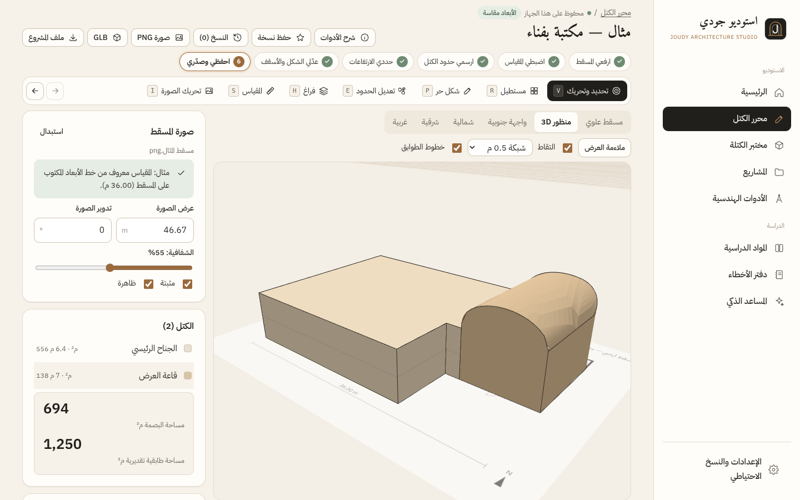
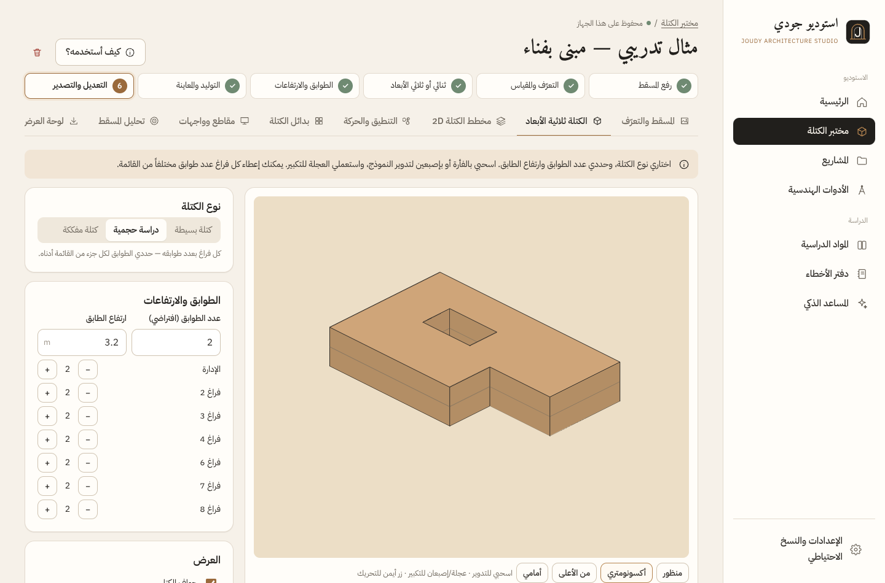
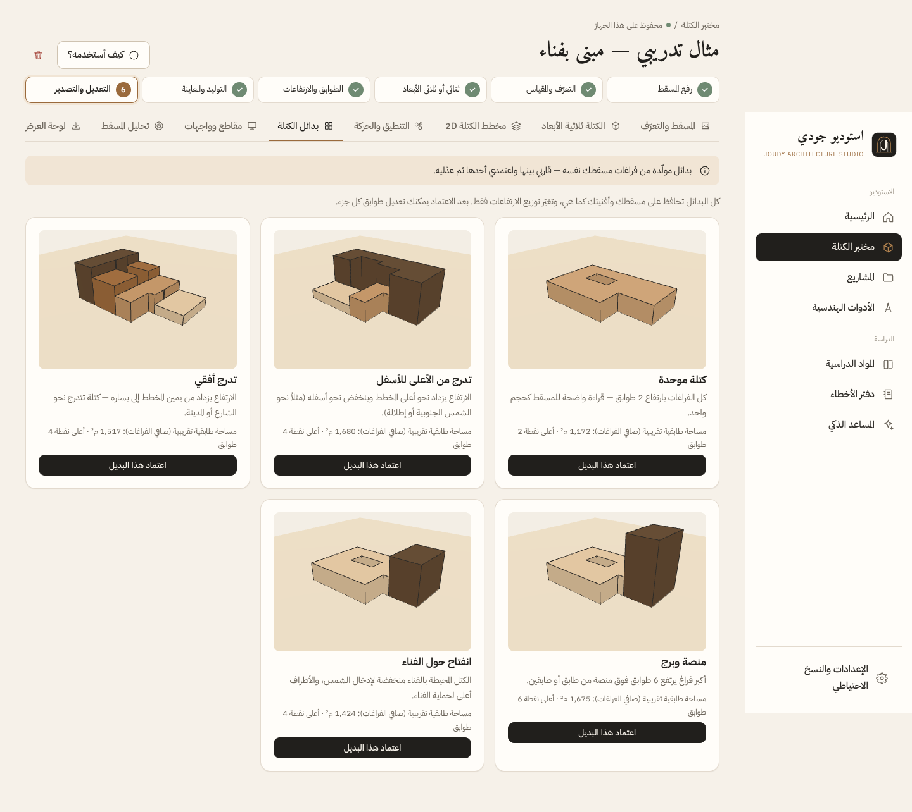
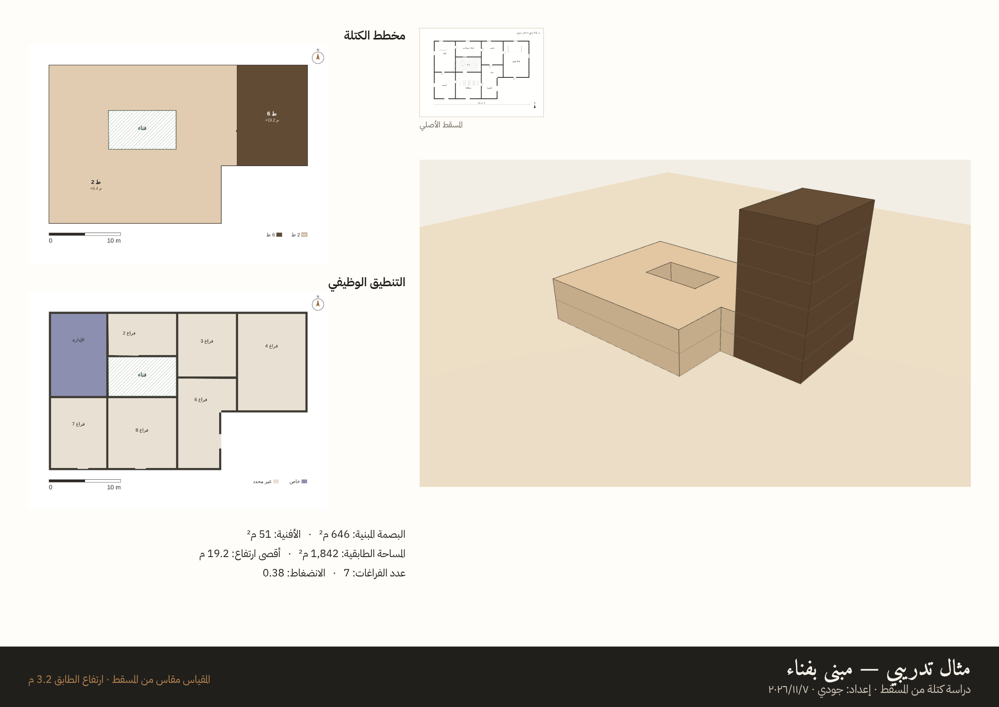

# Joudy Architecture Studio — استوديو جودي المعماري

A private, Arabic-first (RTL) Progressive Web App made as a gift for **Joudy**, a fourth-year architecture student at Tartous University. It covers the full studio workflow for her architecture projects, engineering tools, study tracking for her 11 subjects, and an AI assistant that is ready but switched off for now (see below).

> تطبيق شخصي لجودي: مشاريع معمارية بست مراحل، أدوات هندسية دقيقة تعمل بدون إنترنت، تتبع للمواد الدراسية ودفتر أخطاء، ومساعد ذكي جاهز للتفعيل عند توفر مزود متاح رسمياً في سوريا. كل البيانات محفوظة على جهازها فقط مع نسخ احتياطي كامل.

## New: Massing Editor (محرر الكتل) — Joudy designs the masses herself

An interactive 3D editor where each mass is a real geometric object in the scene, not a generated picture. Built for a Windows laptop with mouse and keyboard.

**Workflow:** upload the plan → set the scale if a dimension is known → draw the mass outlines → set the heights → edit the shape and roofs → save and export.

| Capability | How |
|---|---|
| Plan as reference | Upload an image or PDF. Adjust its width, rotation and opacity; lock it or move it. |
| Scale | Click two ends of a known dimension and type its length. The image and all drawn masses are rescaled together. Until then every dimension is marked **approximate (≈)**. |
| Draw masses | Rectangle (R), or a free/irregular polygon (P) with grid and vertex snapping and 15° angles (Shift). |
| Select / move / rotate / copy / delete | Click, Shift+click, drag, rotation handle or `[` `]` keys, Ctrl+D, Delete, arrow keys to nudge. |
| Dimensions | Drag the corner or side handles, or type the exact length, width, height, floors, floor height, base level and rotation. |
| Height by dragging | In the 3D view, drag the bronze sphere on top of the selected mass. |
| Edit the outline | Edit tool (E): drag vertices, drag the edge mid-handles to **curve walls**, double-click to add a vertex, Delete to remove one, and set the **corner radius** per vertex or for all corners. |
| Merge / voids | Merge touching masses (M). Draw a void (H) only where you want one (courtyard or cut-out) and close it again with one click. No courtyard is ever added automatically. |
| Roofs | Flat, shed, gable, hip, plus **curved**: barrel vault, dome and flowing wave, each with a rise and a direction. |
| Views | Top plan, 3D perspective (orbit, zoom, pan) and 4 elevations (N, S, E, W). |
| History and saving | Undo/redo (Ctrl+Z / Ctrl+Y, 150 steps), autosave, named versions (Ctrl+S) that reopen for editing. |
| Export | PNG of any view, **GLB** model, and a **re-editable project file** (`.joudy-massing.json`, includes the plan image). |

From the Massing Lab, "Open in massing editor" (فتح في محرر الكتل) turns an automatically generated massing into editable masses.



## Massing Lab (مختبر الكتلة) — from floor plan to massing

Upload a floor plan (image, screenshot or PDF). The app **reads the drawing itself**: it finds the walls, the building outline, the rooms, the courtyards and the doors. It then builds outputs derived from that plan:

| Output | What you get | Exports |
|---|---|---|
| 3D massing | Simple block, volumetric study (floors per space) or exploded floors; rotate, zoom, pan; real sun and shadow study | PNG, PDF, **GLB**, **OBJ** |
| 2D massing diagram | Top view coloured by height, hatched courtyards, north arrow, scale bar | PNG, PDF, SVG |
| Zoning, circulation, bubble diagram | Zone colours, walking-distance heat-map from the entrances, a bubble diagram built from the detected doors; import the spaces into the project's space schedule | PNG, PDF, SVG |
| Massing alternatives | Uniform, stepped (2 directions), podium and tower, courtyard-opening — all from your own spaces | — |
| Sections and elevations | Elevations with a parametric façade study (bay, window-to-wall ratio, shading by true orientation); movable section line | PNG, PDF, SVG |
| Plan analysis | Spaces without a façade or courtyard, deep spaces (more than 7.5 m from a façade), spaces with no detected door, escape distances | — |
| Presentation board | A3 sheet with the 3D view, massing plan, zoning, areas table and original plan | PNG, PDF |

**Measured vs estimated:** without a reference dimension, metres are *estimated* (the footprint's long side is assumed to be 40 m), and every output says so. Click two points of a known dimension, or enter the overall width, to make the metres *measured*. Everything runs on the device with no AI service and no network.





## Status: Milestone 1 delivered

| Area | State |
|---|---|
| Premium PWA shell: welcome, dashboard, sidebar (desktop) and bottom nav (phone), install, offline, update banner | ✅ |
| **Project Studio**: create, edit, duplicate, archive, delete, autosave, revision history, and the 6 stages (site with a real sun path, concept with a weighted comparison, space program with net→gross/FAR/coverage and an adjacency matrix with a bubble diagram, drawings with versions, zoom and compare, structured design review, presentation planner) plus tasks, decisions, references and a printable PDF report | ✅ |
| Local storage (IndexedDB) for projects, images and PDFs, plus backup export/import, storage warnings and data migrations | ✅ |
| 10 engineering tools (scale, area, stairs, quantities, RC practice, materials and U-value, space schedule, checklists, units, measurement) | ✅ |
| 11 subjects: editable study plans, progress, exam dates, notes, references; mistake notebook with active review | ✅ (tracking) |
| Curated lessons, worked examples and question banks for the 11 subjects | ⏳ Milestone 2 |
| AI backend (Cloudflare Worker) with a hard €5 cap, auth, limits and a project-aware assistant UI | ✅ built and tested · **⛔ disabled**: no major provider currently supports Syria |

See [`docs/AI-FEASIBILITY.md`](docs/AI-FEASIBILITY.md), [`docs/DEPLOYMENT.md`](docs/DEPLOYMENT.md), [`docs/TESTING.md`](docs/TESTING.md) and [`docs/ROADMAP.md`](docs/ROADMAP.md).

## Project structure
```
src/
  db/          IndexedDB schema, repository, backup (.zip), migrations
  lib/         sun position (NOAA), program maths, calculators (lib/calc), hooks, formatting
  data/        subjects (11) and architectural checklists / critique criteria
  components/  UI kit, icons, SVG art, drawing viewer, sun-path and bubble diagrams
  pages/       dashboard, projects, project workspace (one file per stage), tools, academy, mistakes, assistant, settings
  ai/          browser client for the private AI backend (no keys)
worker/        Cloudflare Worker: auth, limits, budget ledger (Durable Object), OpenAI-compatible provider call
tests/         unit tests (vitest + fake-indexeddb)
scripts/       e2e browser test, icon generator
```

## Academic honesty
The subject outlines and checklists are built from standard architecture and engineering curricula and published references. They are **not** official Tartous University material, and the app says so wherever they appear. Structural tools follow ACI 318-19, state their assumptions and units, and are labelled educational only.

## Privacy
There are no accounts, no analytics and no third-party requests. Fonts are self-hosted. Data never leaves the device except AI messages, and only once the assistant is enabled. The UI is private in practice (data exists only on Joudy's devices). Real server-side access control exists only in the AI backend (a hashed personal token checked on the server).
